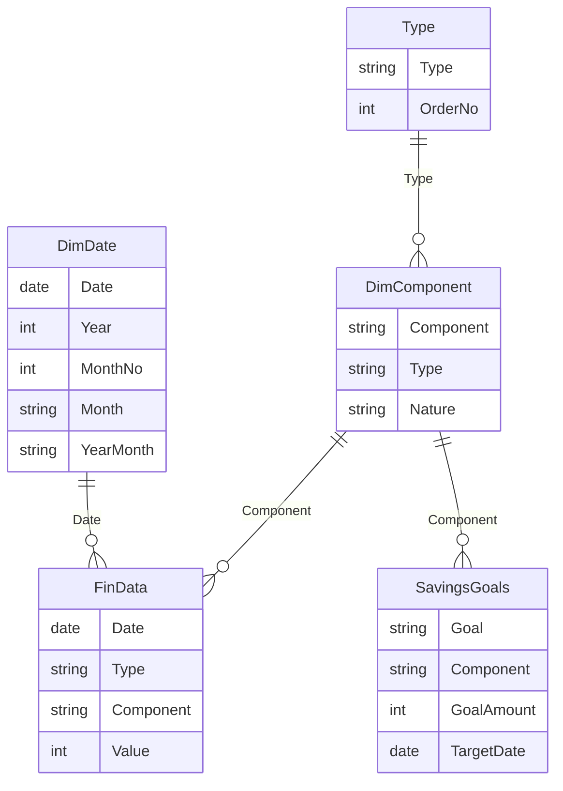

# Finance-Power-BI-Dashboard-Project

# 💰 Personal Finance Health Dashboard (Power BI)

An interactive one-page Power BI dashboard that shows whether monthly income, spending and savings are in balance, and how healthy the overall financial position is. It combines a clean star-style data model, 25 DAX items and a single scoring measure (Financial Health Score) on top of 37 months of personal finance data (Jan 2018 to Jan 2021, amounts in ₹).


---

## 📌 Project Overview

Most people know their salary but not where it goes. This project turns a monthly income / expense / savings sheet into a decision-support dashboard that answers one question: **"Am I living within my means, and is my money working for me?"**

**Who it is for:** salaried individuals, personal finance coaches, or a "money health" screen inside a budgeting app.

## 🎯 Business Questions

1. Does spending track income, or is lifestyle growing faster than earnings?
2. Is the savings rate healthy compared with a target?
3. How heavy are fixed obligations (house rent and EMIs)?
4. Is there a sufficient emergency fund?
5. Where does the money go, and where is it saved?

## 📂 Dataset

**File:** `Finance_Database.xlsx` (sheet `Data`)

| Item | Detail |
|---|---|
| Period | Jan 2018 to Jan 2021 (37 months) |
| Format | Wide: one row per component, one column per month |
| Rows after unpivot | 444 (12 components × 37 months) |
| Currency | Indian Rupees (₹) |

| Type | Components |
|---|---|
| Income | Salary, Source 2 |
| Savings | Mutual funds, Fixed Deposit, Emergency Fund, Liquid Cash |
| Expense | House Rent, EMIs, Groceries & Food, Health, Leisure, Shopping |

In every month, Income = Expense + Savings, so Expense % and Savings % always add up to 100%. The model includes a data-check measure (`Unallocated Cash`) to confirm this.

## 🛠️ Tools and Skills

- **Power BI Desktop**: data modelling, visuals, report design
- **Power Query (M)**: unpivot, date creation, text cleaning, type conversion
- **DAX**: calculated table, time intelligence, ratios, scoring logic
- **Excel**: source data

## 🧹 Data Preparation (Power Query)

1. Load the `Data` sheet, skip the blank first row and promote the second row to headers.
2. Unpivot the month columns into `Month` and `Value`.
3. Build a real date from the month text (avoids "Jan-18" being read as 18 January):
4. Set data types (`Value` whole number, `Date` date, others text) and trim text columns.
5. Check for duplicates on `Date` + `Component` (none expected).

```powerquery
let
  Source   = Excel.Workbook(File.Contents("Finance_Database.xlsx"), null, true),
  Data     = Source{[Item="Data", Kind="Sheet"]}[Data],
  Promoted = Table.PromoteHeaders(Table.Skip(Data, 1), [PromoteAllScalars=true]),
  Unpiv    = Table.UnpivotOtherColumns(Promoted, {"Type","Component"}, "Month", "Value"),
  AddDate  = Table.AddColumn(Unpiv, "Date", each Date.FromText("01-" & [Month], [Culture="en-US"]), type date),
  Final    = Table.TransformColumnTypes(Table.RemoveColumns(AddDate, {"Month"}),
             {{"Type", type text}, {"Component", type text}, {"Value", Int64.Type}})
in Final
```

## 🗺️ Data Model

One fact table (`FinData`) filtered by lookup tables. `Type` filters `DimComponent`, which filters `FinData`, so every relationship is **many-to-one with a single filter direction**.



| Table | Role | Notes |
|---|---|---|
| `FinData` | Fact | Date, Type, Component, Value |
| `DimDate` | Date dimension | Calculated table, marked as date table |
| `Type` | Lookup | Income / Savings / Expense, sorted by `Order No` |
| `DimComponent` | Lookup | Component, Type and **Nature** (Fixed, Essential, Discretionary, Investment, Safety, Income stream) |
| `SavingsGoals` | Small lookup | Goals linked to savings components |
| `Target` | What-if parameter | Savings target slider (10% to 40%), no relationships |
| `Key measures` | Measure table | Holds all DAX measures, no relationships |

## 📐 DAX Measures (25)

One calculated table plus 24 measures.

| # | Name | Purpose |
|---|---|---|
| 1 | `DimDate` | Calendar table |
| 2 | `Total Income` | Sum of Income |
| 3 | `Total Expense` | Sum of Expense |
| 4 | `Total Savings` | Sum of Savings |
| 5 | `Expense %` | Expense as a share of income |
| 6 | `Savings Rate %` | Savings as a share of income |
| 7 | `Unallocated Cash` | Data check, should be 0 |
| 8 | `Income LM` | Income in the previous month |
| 9 | `Income MoM %` | Month-on-month income growth |
| 10 | `Expense MoM %` | Month-on-month expense growth |
| 11 | `Income YoY %` | Year-on-year income growth |
| 12 | `Expense YoY %` | Year-on-year expense growth |
| 13 | `Lifestyle Inflation Gap` | Expense growth minus income growth |
| 14 | `Cumulative Savings` | Running total of savings |
| 15 | `Avg Monthly Expense (3M)` | Average expense over the last 3 months |
| 16 | `Savings Target %` | Target from the slider (default 20%) |
| 17 | `Savings Gap` | Target savings minus actual savings |
| 18 | `Target Status` | "On target" or "Below target" |
| 19 | `EMI Burden %` | EMIs as a share of income |
| 20 | `Fixed Obligation %` | Rent plus EMIs as a share of income |
| 21 | `Emergency Fund Coverage (Months)` | Emergency fund divided by average monthly expense |
| 22 | `Financial Health Score` | 0 to 100 composite score |
| 23 | `Share of Type %` | Category share within its Type |
| 24 | `Top Expense Category` | Largest expense component |
| 25 | `Months Below Target` | Months with a savings rate under target |

<details>
<summary><b>Click to view all DAX code</b></summary>

```dax
// 1. Calculated table: mark as date table
DimDate =
ADDCOLUMNS (
    CALENDAR ( DATE ( 2018, 1, 1 ), DATE ( 2021, 1, 31 ) ),
    "Year", YEAR ( [Date] ),
    "Month No", MONTH ( [Date] ),
    "Month", FORMAT ( [Date], "MMM" ),
    "Year-Month", FORMAT ( [Date], "YYYY-MM" )
)

// 2
Total Income = CALCULATE ( SUM ( FinData[Value] ), FinData[Type] = "Income" )
// 3
Total Expense = CALCULATE ( SUM ( FinData[Value] ), FinData[Type] = "Expense" )
// 4
Total Savings = CALCULATE ( SUM ( FinData[Value] ), FinData[Type] = "Savings" )
// 5
Expense % = DIVIDE ( [Total Expense], [Total Income] )
// 6
Savings Rate % = DIVIDE ( [Total Savings], [Total Income] )
// 7  Data check: should be 0 in every month
Unallocated Cash = [Total Income] - [Total Expense] - [Total Savings]

// 8
Income LM = CALCULATE ( [Total Income], DATEADD ( DimDate[Date], -1, MONTH ) )
// 9
Income MoM % = DIVIDE ( [Total Income] - [Income LM], [Income LM] )
// 10
Expense MoM % =
VAR LM = CALCULATE ( [Total Expense], DATEADD ( DimDate[Date], -1, MONTH ) )
RETURN DIVIDE ( [Total Expense] - LM, LM )
// 11
Income YoY % =
VAR LY = CALCULATE ( [Total Income], SAMEPERIODLASTYEAR ( DimDate[Date] ) )
RETURN DIVIDE ( [Total Income] - LY, LY )
// 12
Expense YoY % =
VAR LY = CALCULATE ( [Total Expense], SAMEPERIODLASTYEAR ( DimDate[Date] ) )
RETURN DIVIDE ( [Total Expense] - LY, LY )
// 13  Positive = spending grows faster than income
Lifestyle Inflation Gap = [Expense YoY %] - [Income YoY %]
// 14
Cumulative Savings =
CALCULATE ( [Total Savings], FILTER ( ALL ( DimDate ), DimDate[Date] <= MAX ( DimDate[Date] ) ) )
// 15
Avg Monthly Expense (3M) =
VAR Last3 = DATESINPERIOD ( DimDate[Date], MAX ( DimDate[Date] ), -3, MONTH )
RETURN DIVIDE ( CALCULATE ( [Total Expense], Last3 ), CALCULATE ( DISTINCTCOUNT ( FinData[Date] ), Last3 ) )

// 16  Reads the What-if slider; defaults to 20%
Savings Target % = SELECTEDVALUE ( 'Target'[Target], 0.2 )
// 17  Positive = shortfall in rupees
Savings Gap = [Savings Target %] * [Total Income] - [Total Savings]
// 18
Target Status = IF ( [Savings Rate %] >= [Savings Target %], "On target", "Below target" )
// 19
EMI Burden % = DIVIDE ( CALCULATE ( [Total Expense], FinData[Component] = "EMIs" ), [Total Income] )
// 20
Fixed Obligation % =
DIVIDE ( CALCULATE ( [Total Expense], FinData[Component] IN { "House Rent", "EMIs" } ), [Total Income] )
// 21
Emergency Fund Coverage (Months) =
VAR EF =
    CALCULATE (
        SUM ( FinData[Value] ),
        FinData[Component] = "Emergency Fund",
        FILTER ( ALL ( DimDate ), DimDate[Date] <= MAX ( DimDate[Date] ) )
    )
RETURN DIVIDE ( EF, [Avg Monthly Expense (3M)] )
// 22  Weights: 40 savings rate, 30 fixed obligations, 30 emergency fund
Financial Health Score =
VAR S = MIN ( DIVIDE ( [Savings Rate %], [Savings Target %] ), 1 ) * 40
VAR F = ( 1 - MIN ( DIVIDE ( [Fixed Obligation %], 0.5 ), 1 ) ) * 30
VAR E = MIN ( DIVIDE ( [Emergency Fund Coverage (Months)], 6 ), 1 ) * 30
RETURN ROUND ( S + F + E, 0 )

// 23
Share of Type % =
DIVIDE ( SUM ( FinData[Value] ), CALCULATE ( SUM ( FinData[Value] ), ALLEXCEPT ( FinData, FinData[Type] ) ) )
// 24
Top Expense Category =
VAR T = TOPN ( 1, CALCULATETABLE ( VALUES ( FinData[Component] ), FinData[Type] = "Expense" ), [Total Expense], DESC )
RETURN CONCATENATEX ( T, FinData[Component], ", " )
// 25
Months Below Target =
COUNTROWS ( FILTER ( VALUES ( DimDate[Year-Month] ), [Savings Rate %] < [Savings Target %] ) )
```

</details>

### Financial Health Score logic

| Component | Weight | Full points when |
|---|---|---|
| Savings rate | 40 | Savings rate reaches the target (default 20%) |
| Fixed obligations (rent + EMIs) | 30 | Fixed obligations are 0% of income (0 points at 50% or more) |
| Emergency fund | 30 | Fund covers 6 months of average expenses |

These weights and thresholds are design assumptions and can be changed in the measure.

## 📊 Dashboard Overview

A single-page report with:

| Section | Visual | Measures used |
|---|---|---|
| Filters | Year slicer, month slicer, savings target slider | `DimDate`, `Target` |
| KPI cards | Total Income, Expense Ratio, Savings Rate, Total Savings Accumulated, EMI Burden, Emergency Fund Cover | #2, #5, #6, #14, #19, #21 |
| Trend | Line chart: expense ratio and savings rate vs target | #5, #6, #16 |
| Health | Gauge: Financial Health Score | #22 |
| Growth | Column chart: income vs expense growth (YoY) | #11, #12, #13 |
| Spending | Bar chart: expense breakdown by category | #23 |
| Savings | Bar chart: savings allocation by instrument | #23 |
| Structure | Donut: expense by nature (Fixed, Essential, Discretionary) | #3 |
| Statement | Matrix: income, savings and expense by year | `FinData[Value]` |

## 🔍 Key Insights

- **Savings rate fell every full year:** 26.7% (2018), 23.4% (2019), 16.7% (2020).
- **Spending grew faster than income:** monthly income rose 85% (₹31,000 to ₹57,500) while monthly expenses rose 112% (₹21,000 to ₹44,500) between Jan 2018 and Jan 2021. Monthly savings moved only from ₹10,000 to ₹13,000.
- **Lifestyle inflation gap:** expenses outgrew income by 5.2 points in 2019 and 11.3 points in 2020.
- **EMIs grew from ₹2,500 to ₹12,000 a month.** Rent plus EMIs equal 48.7% of Jan 2021 income, and 61.8% of all expenses over the period.
- **Spending mix:** House Rent 40.4%, Groceries & Food 24.2%, EMIs 21.4%.
- **Savings mix:** 71.6% in mutual funds, 14.4% emergency fund, 13.7% fixed deposit, 0.3% liquid cash.
- **Thin safety net:** emergency fund contributions of ₹47,000 cover about 1.1 months of expenses, compared with the commonly suggested 3 to 6 months.
- **Months below the 20% target:** 12 of 37, including 9 in 2020. December 2019 saved only 1.3% of income.

## ⚠️ Assumptions and Limitations

- 2021 contains only January, so 2021 totals and growth figures are not comparable with full years.
- Emergency Fund rows are treated as contributions only (no withdrawals), so coverage is an estimate.
- "Total Savings Accumulated" is the sum of savings contributions. It does not include investment returns, opening balances or debt, so it is not true net worth.
- The Financial Health Score weights and the 20% savings target are adjustable assumptions, not financial advice.
- Month-over-month measures are meaningful at month level; at year level they compare shifted windows.

## 🚀 How to Use

1. Install [Power BI Desktop](https://powerbi.microsoft.com/desktop/) (Windows).
2. Download `Personal_Finance_Dashboard.pbix` and `Finance_Database.xlsx`.
3. Open the `.pbix` file. If Power BI cannot find the data, go to **Home → Transform data → Data source settings → Change Source** and point to your copy of `Finance_Database.xlsx`.
4. Use the Year and month slicers to filter, and the Target slider to test different savings targets.

## 📁 Repository Structure

```
├── Personal_Finance_Dashboard.pbix   # Power BI report
├── Finance_Database.xlsx             # Source data
├── images/
│   └── dashboard.png                 # Dashboard screenshot
└── README.md
```

## 🔮 Future Improvements

- Budget table (planned vs actual spending by month)
- Savings goal progress measure using the `SavingsGoals` table
- Forecast of savings and emergency fund coverage
- Publish to Power BI Service with a scheduled refresh

## 👤 Author

Mahalakshmi S
LinkedIn --https://www.linkedin.com/in/mahalakshmi-s-454497281/
 · GitHub --https://github.com/mowriyaathl-comp
  · Email -- mowriyaathl@gmail.com

---
⭐ If you find this project useful, consider giving it a star.